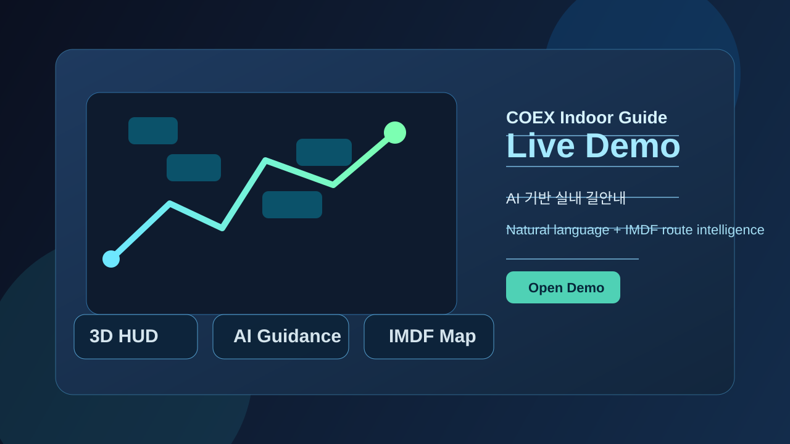

# 🧭 코엑스-파르나스 실내 길라잡이 AI (IMDF Live Demo)



> GPS가 닿지 않는 대형 복합 지하 공간에서 자연어 발화만으로 위치를 추론하고, 실시간으로 이탈을 감지해 경로를 보정하는 대화형 실내 내비게이션 데모입니다.

## 🔗 프로젝트 링크
- 배포 주소: https://coex-indoor-guide-demo.vercel.app
- GitHub 저장소: https://github.com/Shiene1010/coex-indoor-guide-demo

---

## 1. 프로젝트 소개
코엑스몰(B1)을 가로질러 웨스틴 서울 파르나스 하모니 볼룸까지 이동하는 실전 시나리오를 바탕으로 설계된 데모입니다.

이 프로젝트는 Apple IMDF(Indoor Mapping Data Format) 기반 공간 정보와 한국어 네 마디 워드주소 구조를 결합해, 사용자가 자연어로 위치를 설명하면 현재 위치를 추정하고 경로를 안내하는 인터랙티브 실내 네비게이션을 구현합니다.

핵심 의도는 단순히 “가장 빠른 경로를 보여주는 것”이 아니라, 같은 공간에서도 사용자 유형에 따라 안내 방식이 달라져야 한다는 점을 비교 시나리오로 보여주는 것입니다.

- 길라임 시나리오: 목적지까지 가장 짧은 경로를 유지함
- 막해일 시나리오: 별마당을 지나 로비 밖으로 벗어나다가 다시 전시장 쪽으로 복귀하는 패턴을 보임
- 시스템은 오진입을 감지하고, 기준점과 네 마디 주소를 다시 조합해 회복형 안내를 제공함
- 최종적으로 웨스틴 서울 파르나스 로비까지 안정적으로 안내함

---

## 2. 핵심 기능

### 자연어 기반 위치 추론
- “파르나스 타워”, “별마당 도서관”, “아쿠아리움”, “웨스틴 로비” 같은 실제 사용자 표현을 노드 기준으로 매칭
- 키워드 정규화 및 경로 상태 판별 로직 포함

### 이탈 감지 및 재탐색
- 오진입 구간 감지 시 경고 HUD 전환
- 즉시 경로 재탐색 메시지 생성
- 사용자에게 안전한 경로로 회귀 안내

### 시나리오별 안내 전략
- 길라임 시나리오: 직선형 최단 경로 안내
- 막해일 시나리오: 회복형 복귀 안내와 기준점 재설정
- 사용자 인지 수준에 따라 현재 위치, 마지막 안전 지점, 다음 경로를 함께 설명

### 경로 그래프 기반 네비게이션
- IMDF 노드 간 연결 관계를 그래프로 정의
- 현재 위치에서 목적지까지 최단 경로를 계산
- 경로 미리보기 및 다음 지점 안내 제공

### 분석 대시보드
- 이탈 감지 횟수
- 도착 성공 횟수
- 긴급 재탐색 횟수
- 로그 기반 사용자 행동 추적

---

## 3. 데모 시나리오

웹 앱 하단의 시연 버튼을 눌러 아래 흐름을 비교해 볼 수 있습니다.

1. 길라임 시나리오
   - 삼성역 진입
   - 가장 짧은 경로로 목적지를 향해 직진
   - 안정적인 경로 유지
2. 막해일 시나리오
   - 별마당을 지나 로비 밖으로 이동하는 패턴 발생
   - 오진입 감지와 재탐색 경고 출력
   - 다시 기준점을 찾아 전시장 쪽으로 복귀
3. 회복형 안내
   - 현재 위치, 마지막 안전 지점, 다음 방향을 설명
   - IMDF 네 마디 주소 기반으로 길잡이 문장 제공
4. 목적지 도착
   - 웨스틴 로비 도착 상태 갱신
   - 최종 안내 완료

---

## 4. 기술 스택
- Frontend: HTML5, CSS3, JavaScript(ES6+)
- Spatial Data: Apple IMDF
- Interaction: Chat-style guided navigation UI
- Visualization: HUD, route preview, analytics panel

---

## 5. 파일 구조

```text
coex-indoor-guide-demo/
├── index.html          # 메인 UI / HUD / 미니맵 / 분석 대시보드
├── style.css           # 모바일 퍼스트 레이아웃 및 경고 애니메이션
├── app.js              # 자연어 인식, 경로 계산, 이탈 감지, 분석 로그
├── imdf-sample.json    # IMDF 샘플 데이터 및 경로 그래프
├── model-guide.md      # AI 프롬프트/모델 설계 문서
├── thumbnail.svg       # 프로젝트 썸네일 이미지
├── README.md           # 프로젝트 소개 및 배포 가이드
└── .gitignore          # Git 관리 제외 파일
```

---

## 6. 로컬 실행 방법
`app.js`가 `fetch('imdf-sample.json')`을 로드하므로, 단순 파일 열기 대신 로컬 웹 서버를 통해 실행하는 것이 안전합니다.

### VS Code 사용자
- Live Server 확장 설치
- `index.html` 우클릭 → `Open with Live Server`

### Python 사용자
```bash
cd coex-indoor-guide-demo
python -m http.server 8000
```
브라우저에서 `http://localhost:8000` 접속

---

## 7. 배포 상태
- 배포 URL: https://coex-indoor-guide-demo.vercel.app
- GitHub 저장소: https://github.com/Shiene1010/coex-indoor-guide-demo

현재 프로젝트는 정적 웹사이트로 Vercel에 배포되어 있으며, GitHub 저장소와 연결 상태도 유지되고 있습니다.

---

## 8. 향후 확장 방향
- 실제 IMDF 지도 데이터 전체 적용
- LLM 기반 자연어 이해 고도화
- 사용자 위치 추정 모델 연동
- 고급 경로 시각화 및 지도 기반 UI 추가
- 대규모 사용자 로그 기반 경로 최적화

---

## 9. 요약
이 프로젝트는 단순한 안내 데모를 넘어, 같은 실내 공간에서도 사용자 유형에 따라 필요한 안내가 달라진다는 점을 비교할 수 있는 실내 네비게이션 시나리오를 구현한 데모입니다.

핵심 가치는 다음과 같습니다.

- 길라임은 가장 빠른 경로를 안내한다.
- 막해일은 길을 잃는 지점에서 다시 기준점을 잡아야 한다.
- 이 서비스는 오진입과 반복 회복 상황에서, 현재 위치와 마지막 안전 지점을 기준으로 다시 길을 잡아주는 회복형 안내를 제공한다.
- 세션 종료 후 새로 시작 버튼으로 시나리오를 초기화하고 다시 비교할 수 있다.

결국 이 프로젝트는 “목적지까지 가는 길”보다 “길을 잃는 순간을 복구하는 안내”가 얼마나 중요한지 보여주는 데모입니다.
